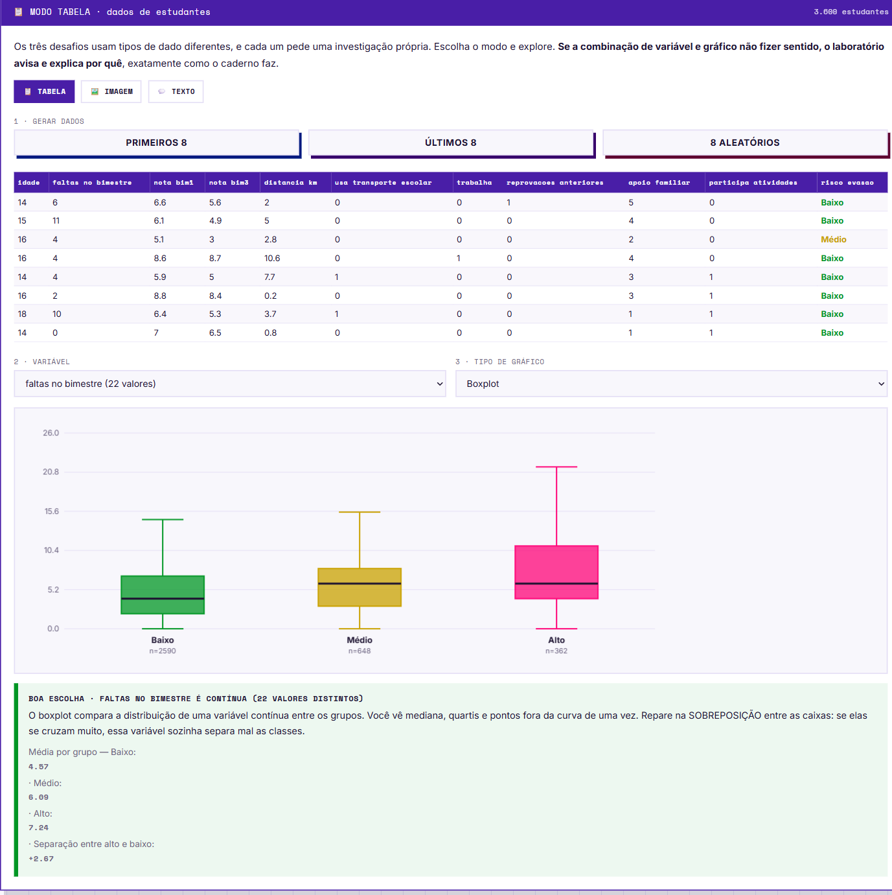

# Capítulo 1 · Ética, dados e o mapa da Fase 1

Base para os três desafios. 7 seções, 1 laboratório, 3 atividades, ≈50 min.

## 1.1 · A IA já está decidindo coisas sobre você

Exemplos do cotidiano: feed do Instagram/TikTok, matchmaking de Free Fire/Brawl Stars, playlist recomendada.
**O ponto:** ninguém escreveu a regra "se o usuário tem 16 anos, mostre vídeo de dança". O modelo descobriu sozinho olhando milhões de comportamentos.

### Quando a decisão automática pesa de verdade

| Cenário | Lição |
|---|---|
| Escola gera lista de 47 estudantes em risco | **Caminho A:** a lista vira *atenção* (reforço, conversa, família). **Caminho B:** vira *rótulo* — os estudantes percebem, desanimam, evadem e confirmam a previsão. Mesma tecnologia, resultados opostos. Isso é **ciclo de retroalimentação**. |
| Filtro de comentários apaga mais mensagens de um grupo | O modelo associou **o jeito de falar** (gírias de região/comunidade/faixa etária) à agressividade, não o conteúdo. É **viés**, quase nunca intencional. O detalhe cruel: a taxa de erro *geral* pode ser ótima — o erro se concentra em quem já era minoria nos dados. |

### Dado pessoal vs. dado sensível

- **Pessoal:** identifica ou permite identificar (nome, CPF, endereço, telefone, e-mail, foto do rosto, matrícula).
  Cuidado com a **combinação**: "mora em Goiânia" não identifica; "mora em Goiânia + 16 anos + escola X + time Y" identifica.
- **Sensível** (proteção reforçada, pode gerar discriminação): saúde, biometria, origem racial ou étnica, religião, opinião política, filiação sindical, vida sexual.
  **Todo dado de criança e adolescente entra aqui** — logo, vale para os próprios competidores (14–19 anos). Lei: **LGPD**.

Nos desafios os dados são **anonimizados ou sintéticos**. É decisão de projeto, não formalidade.

### Viés de coleta — a pergunta que quase ninguém faz

> **Quem ficou de fora destes dados?**

App de saúde testado só em hospitais de capital aprende a realidade da capital; aplicado no interior erra sistematicamente, e o erro recai sobre quem já tinha menos acesso. **O que não foi medido também decide o resultado.**

## 1.2 · Programar uma regra ou treinar um modelo

| Jeito tradicional | Aprendizado de máquina |
|---|---|
| `se faltas > 15: risco = "alto"` | `modelo.fit(exemplos, respostas)` |
| Uma pessoa decidiu que o limite é 15 | Ninguém escreveu limite; o modelo achou sozinho |
| Se o limite certo for 12, alguém precisa perceber e reescrever | Se o limite certo for 12, ele descobre — e acha combinações que nenhum humano notou |

**O que é um modelo:** uma função que recebe características e devolve uma resposta, ajustada a partir de exemplos. Um objeto matemático, nada além.
**O que não é:** cérebro, oráculo. Não "sabe" nada além do que estava nos dados. Dados tortos → aprende torto e erra **com muita confiança**.

### Generalizar (a palavra mais importante)

Modelo que acerta tudo o que já viu e erra no novo **não vale nada**. Reproduzir não é aprender.
*Analogia:* decorar o gabarito da lista de exercícios. Prova igual → dez. Prova nova → zero.
É por isso que guardamos parte dos dados escondida do modelo.

## 1.3 · O ciclo: treinar → prever → avaliar

| Etapa | O que acontece |
|---|---|
| **Treinar** | Mostrar exemplos **com** a resposta certa; o modelo ajusta parâmetros internos |
| **Prever** | Apresentar casos novos, **sem** resposta; o modelo devolve o palpite |
| **Avaliar** | Comparar palpite com a verdade: quanto acertou e, principalmente, **como** errou |

**Notação de todo caderno:** `X` = matriz de características (o que o modelo *olha*). `y` = vetor de respostas (o que ele tenta *acertar*).

## 1.4 · Jupyter — cinco coisas que evitam 90% dos perrengues

1. **`In [1]`, `In [2]`… contam a ordem de execução**, não a ordem na tela. `In [7]` em cima e `In [3]` embaixo significa que alguém rodou fora de ordem. Explica quase todo comportamento estranho.
2. **`In [*]` quer dizer "está rodando".** Se travar numa célula simples: `Kernel → Restart`.
3. **Mudar um controle não muda nada sozinho** — sem rodar a célula, o resultado antigo fica na tela. Causa nº 1 de "não mudou nada".
4. **As células compartilham memória.** Variável criada na célula 3 existe na 8. Se a célula que cria `dados` não rodou, qualquer uso de `dados` dá erro de nome inexistente.
5. **Atalhos:** `Shift+Enter` roda e avança · `Ctrl+Enter` roda e fica · `Kernel → Restart & Run All` reinicia e roda tudo na ordem certa.

> **Regra de ouro:** quando algo estiver esquisito, rode **Restart & Run All**. Na maioria das vezes era ordem de execução.

## 1.5 · O que é um dado

Dado é **registro** de algo que aconteceu — não verdade. O poder vem da quantidade.

| Tipo | Estrutura | No seu mundo |
|---|---|---|
| **Tabela** | Linhas (casos) × colunas (informações) | Classificação do Brasileirão, boletim, inventário do Roblox, extrato do cartão de transporte |
| **Imagem** | Grade de pontos, cada um com 3 números (R, G, B) | Foto do rolo, frame de TikTok, skin, capa de álbum |
| **Texto** | Sequência de palavras de tamanho variável (o mais bagunçado) | Legenda, comentários, grupo da família, manchete, letra de música |

### Os quatro problemas de um conjunto de dados

| # | Problema | Exemplo |
|---|---|---|
| 1 | **Dado faltante** e a **ausência disfarçada** | Colesterol preenchido com `0` não é "colesterol zero", é "não mediram". Se o modelo tratar como valor real, aprende bobagem. Aparece no desafio. |
| 2 | **Desbalanceamento** | 97% normais / 3% golpe: responder "normal" para tudo acerta 97% e é inútil, porque nunca encontra o golpe. |
| 3 | **Duplicata e vazamento** | Mesma foto no treino **e** no teste — o teste vira cola. Nota linda e mentirosa. (Cap. 4 tem uma seção inteira.) |
| 4 | **Correlação enganosa (atalho)** | Modelo descobre que notícias falsas são mais curtas e decide pelo tamanho, não pelo conteúdo. Desaba no mundo real. **Só olhando o dado antes se descobre.** |

## 1.6 · Escolher o gráfico é decisão técnica

Não é enfeite nem gosto pessoal: o gráfico errado esconde justamente a informação procurada.

### Primeiro, o tipo da variável

| Tipo | Como saber |
|---|---|
| **Contínua** (faltas, notas, distância, brilho, nº de palavras) | Conte valores distintos — se forem muitos, é contínua |
| **Categórica/binária** (trabalha, usa transporte, apoio 1–5) | Poucos valores distintos, geralmente menos de 6 |

Os cadernos usam **exatamente esse critério** e avisam quando o gráfico não combina com o tipo — e mostram o gráfico errado de propósito, para vocês verem o problema.

### Os seis gráficos do desafio

| Gráfico | Serve para | Cuidado / esconde |
|---|---|---|
| **Boxplot** | Comparar distribuição de variável contínua entre grupos (mediana, quartis, atípicos) | Esconde o **formato** da distribuição |
| **Histograma sobreposto** | Ver **sobreposição** entre classes | — |
| **Violino** | Distribuições com **dois picos**, que o boxplot esconderia | — |
| **Barras de média** (com erro) | Comparar médias com a incerteza da estimativa | Média sozinha esconde dispersão |
| **Barras de proporção** | Variáveis categóricas: "quem trabalha tem mais risco?" | — |
| **Dispersão** | Procurar **interações** — o único que cruza duas variáveis | — |

### Duas armadilhas de leitura

1. **Médias distantes não bastam.** Se as caixas do boxplot se sobrepõem muito, os grupos continuam difíceis de separar. Olhem a **sobreposição**, não a distância.
2. **Associação não é causa.** Uma variável pode aparecer entre as mais fortes só por estar ligada a uma causa que ninguém mediu.

### Laboratório de gráficos (3 modos)

| Modo | Variáveis disponíveis | Gráficos |
|---|---|---|
| Tabela (3.600 estudantes) | `idade`, `faltas_no_bimestre`, `nota_bim1`, `nota_bim3`, `distancia_km`, `usa_transporte_escolar`, `trabalha`, `reprovacoes_anteriores`, `apoio_familiar`, `participa_atividades` | Boxplot, histograma sobreposto, violino, barras de média, barras de proporção, dispersão |
| Imagem | Descritores: `brilho_medio`, `contraste`, `saturacao_media`, `bordas`, `area_reluzente`, `amplitude_luz`, `vermelho_medio`, `verde_medio`, `azul_medio` | Idem, mais dispersão entre dois descritores |
| Texto | Marcadores linguísticos por classe, termos mais discriminantes, comprimento em caracteres, número de palavras | — |

**Imagem não tem colunas:** antes de qualquer gráfico é preciso **extrair descritores**. Feito isso, cada foto vira uma linha de tabela e os mesmos gráficos voltam a valer.
**Experimento que vale fazer:** dispersão de `area_reluzente` × `saturacao_media` — os 4 materiais ocupam regiões diferentes, e nenhum descritor sozinho conseguiria essa separação.

## Checklist do Capítulo 1

- [ ] Sei explicar a diferença entre escrever uma regra e treinar um modelo
- [ ] Sei o que significa generalizar e por que guardamos dados escondidos do modelo
- [ ] Sei dizer o que é dado pessoal, dado sensível e viés de coleta
- [ ] Sei navegar num caderno Jupyter e sei o que fazer quando algo trava
- [ ] Sei os quatro problemas que um conjunto de dados pode ter
- [ ] Consigo escolher o gráfico certo para uma pergunta e justificar a escolha
