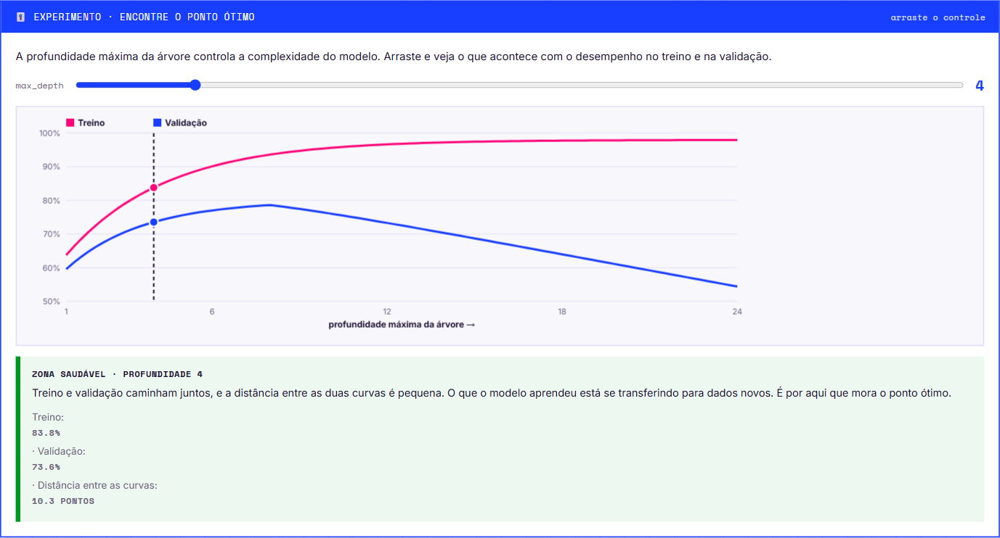
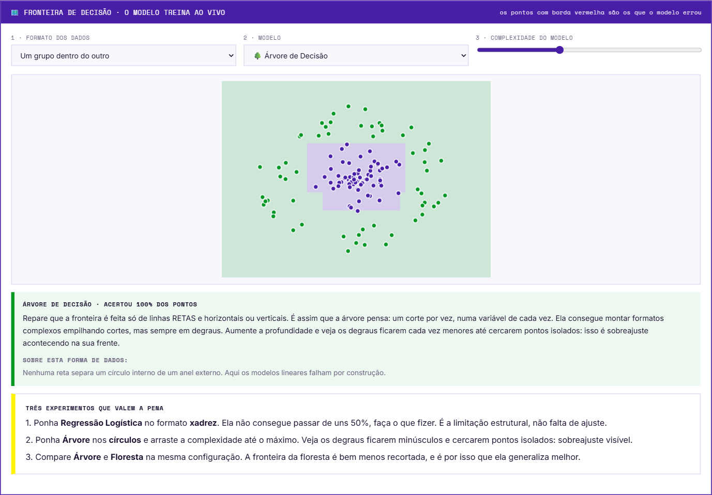
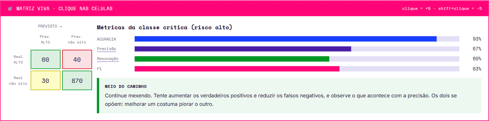

# Capítulo 2 · Dados tabulares

O capítulo que destrava os outros dois. 7 seções, 5 exercícios, 4 atividades, ≈70 min.
Dividir os dados, escolher o modelo, completar o código e ler as métricas se repete quase sem mudança em visão e texto.


## 2.1 · Por que esconder dados do próprio modelo

| Conjunto | Quem usa | O que é |
|---|---|---|
| **Treino** | O modelo aprende | Maior parte do conjunto público; vê exemplos **com** resposta |
| **Validação** | A equipe testa | Fatia guardada do público; simulado **com gabarito** |
| **Teste** | A plataforma corrige | Conjunto separado, **sem** respostas, tamanho fixo e igual para todas as equipes |

**Tamanho fixo da submissão:** 900 linhas (tabular), 240 (visão), 900 (texto). O caderno confere antes de gerar o arquivo — se der diferente, algo está errado no pipeline.

### Sobreajuste e subajuste

| | Sobreajuste (overfitting) | Subajuste (underfitting) |
|---|---|---|
| O que é | Decorou o treino, **inclusive o ruído** | Simples demais, não captura nem o padrão real |
| Sintoma | Ótimo no treino, ruim no novo | Ruim nos dois conjuntos |
| Analogia | Decorou as respostas da lista | Decorou "a resposta é sempre C" |

O equilíbrio entre os dois se chama **compromisso entre viés e variância**. É ele que explica por que profundidade não é "quanto maior melhor".



### Estratificação

Com classes desbalanceadas, sorteio puro pode deixar quase nenhum caso raro na validação. `stratify` força as duas partes a manterem a proporção original.

```python
treino_X, teste_X, treino_y, teste_y = train_test_split(
    atributos, generos, test_size=0.25, random_state=42,
    stratify=generos)

# stratify recebe o vetor de RESPOSTAS, não o de características.
```

> Os exemplos do material usam nomes de outros problemas (músicas, gêneros) **de propósito**: é para entender a estrutura, não decorar linha para copiar.

## 2.2 · Três formas de tomar a mesma decisão

| Modelo | Como pensa | A favor | Contra |
|---|---|---|---|
| **Árvore de Decisão** | Perguntas em sequência, uma variável por vez ("faltou mais de 14 vezes? a nota caiu mais de 1,2?") — o jogo das vinte perguntas | Único que se desenha no papel e se explica para a coordenadora da escola | Instável e viciada em decorar; sem limite cria uma pergunta por estudante |
| **Floresta Aleatória** | Centenas de árvores, cada uma vendo amostra e variáveis diferentes; todas votam | Quase sempre acerta mais e é bem mais estável | Perde a explicação individual |
| **Regressão Logística** | Um peso por variável, soma tudo (faltas +0,4, apoio familiar −0,3) — sistema de pontos de campeonato | Rápida, estável e transparente: dá para olhar os pesos | **Só consegue somar** — não captura interações |

> **Por que a última limitação importa aqui:** os dados do desafio tabular foram construídos **com interações de propósito**. O risco dispara quando faltas altas **e** queda de notas ocorrem juntas, não quando cada uma ocorre sozinha. Modelos de árvore capturam isso naturalmente.

### Galeria de fronteiras de decisão



Treina o modelo ao vivo no navegador e pinta a região de cada classe. Formatos de dados: separável por reta · um grupo dentro do outro · **interação (xadrez)** · duas meias-luas. Modelos: árvore, floresta, logística, SVM RBF, Naive Bayes.

**Três experimentos que valem a pena:**
1. **Regressão Logística no xadrez** — não passa de ~50%, faça o que fizer. Limitação estrutural, não falta de ajuste.
2. **Árvore nos círculos** com complexidade no máximo — degraus minúsculos cercando pontos isolados: sobreajuste visível.
3. **Árvore vs. Floresta** na mesma configuração — a fronteira da floresta é bem menos recortada, e é por isso que generaliza melhor.

## 2.3 · Parâmetro vs. hiperparâmetro

| | Quem define | Exemplos |
|---|---|---|
| **Parâmetro** | O modelo aprende sozinho no treino | Cortes da árvore, pesos da regressão |
| **Hiperparâmetro** | **Vocês** escolhem antes do treino | Profundidade, número de árvores, força da regularização |

> **O conceito que sustenta tudo:** todo parâmetro que você não declara assume, **em silêncio**, um valor padrão. O código funciona só completando as lacunas — mas usa o padrão de tudo, e o padrão nem sempre é bom para o seu problema.

### Os parâmetros que mais mudam o resultado

| Parâmetro | Padrão | O que faz |
|---|---|---|
| `max_depth` | `None` | Até onde a árvore cresce. `None` = sem limite, quase sempre sobreajuste |
| `n_estimators` | `100` | Quantas árvores na floresta. Mais estabiliza e custa tempo |
| `min_samples_leaf` | `1` | Mínimo de exemplos por folha. Aumentar suaviza e contém sobreajuste |
| `max_features` | `'sqrt'` | Quantas variáveis a floresta sorteia por corte. Aceita fração (`0.5`) |
| `C` | `1.0` | Na logística, **inverso** da regularização. Menor que 1 regulariza mais |
| `max_iter` | `100` | Iterações da logística. O padrão frequentemente não converge |
| `class_weight` | `None` | **Merece atenção especial.** `None` nos três modelos: por omissão nenhum compensa o desbalanceamento. `'balanced'` corrige |

> **A ZONA LIVRE do caderno:** área marcada onde a equipe pode acrescentar parâmetros. Quem só completa as lacunas obtém resultado **correto e mediano**; quem estuda a tabela de referência e acrescenta parâmetros obtém consistentemente melhor — nos testes da organização a diferença chega a **mais de dez pontos** na métrica oficial. Tudo o que é necessário está no próprio caderno.

Ficha técnica completa de cada modelo: ver [05-referencia-parametros.md](05-referencia-parametros.md).

## 2.4 · O Python que o caderno exige

São três coisas.

**1. Criar um objeto com argumentos nomeados**

```python
modelo = RandomForestClassifier(n_estimators=200, max_depth=8, random_state=42)
#        ^ nome exato da classe   ^ argumentos nomeados, separados por vírgula
```

O nome da classe precisa ser **exatamente** igual ao da tabela de referência. `randomforestclassifier` não funciona.

**2. A cadeia `if` / `elif` / `else`**

```python
if prioridade == "explicar a decisao":
    classificador = DecisionTreeClassifier(max_depth=5)
elif prioridade == "melhor desempenho":
    classificador = RandomForestClassifier(n_estimators=300)
else:
    classificador = LogisticRegression(max_iter=2000)
```

Três erros que derrubam quem está começando:
1. Escrever `else` com condição — o `else` recebe **só os dois-pontos**.
2. Usar `if` onde deveria ser `elif` — funciona, mas testa todas as condições em vez de parar na primeira verdadeira.
3. Errar a indentação — em Python o recuo **é** a sintaxe.

**3. A interface `fit` / `predict`**

| Método | O que faz |
|---|---|
| `.fit(X, y)` | Ajusta parâmetros internos usando exemplos **e** respostas. **Só no treino.** |
| `.predict(X)` | Infere a classe de casos novos com os parâmetros já ajustados. Recebe só as características. |

Convenção do `scikit-learn`: vale para **todos** os modelos, inclusive os dos capítulos 3 e 4. Trocar de algoritmo não exige reescrever o resto.

> Nenhum exercício do material usa o dataset dos desafios. São **outros problemas** com a mesma interface — para praticar o raciocínio, não decorar gabarito.

## 2.5 · Como saber se o resultado presta

**A lição contraintuitiva: acurácia alta pode significar modelo inútil.**

No desafio tabular, ~72% dos estudantes estão em risco baixo. Um modelo preguiçoso que responde "risco baixo" para todo mundo:

| Métrica | Valor |
|---|---|
| Acurácia | **72%** — sem ter aprendido nada |
| Estudantes em risco alto encontrados | **0** — a única coisa que interessava |
| F1-macro | **~28%** — a métrica que denuncia a farsa |

> **No caderno de verdade:** com a configuração inicial, sem mexer em nada, aparece **acurácia perto de 80% e F1-macro perto de 64%**. Essa distância de 16 pontos é o desbalanceamento aparecendo.

### Matriz de confusão



A métrica resume tudo num número e apaga a informação mais útil: **a direção do erro**. A matriz preserva.

| Métrica | Pergunta que responde | Quando é baixa |
|---|---|---|
| **Precisão** | Das vezes que o modelo **apontou** risco alto, quantas estavam certas? | Alarme falso demais → as pessoas ignoram o sistema |
| **Revocação** | Dos que **realmente** estavam em risco alto, quantos o modelo encontrou? | Gente em risco passando despercebida |
| **F1-macro** | Combina precisão e revocação e tira a **média simples entre classes** | — |

**Por que F1-macro é a métrica oficial:** a média simples entre classes impede o truque do modelo preguiçoso. Ignorar a classe minoritária derruba a nota mesmo com acurácia alta.

Célula fora da diagonal em "real alto, previsto baixo" = **falsos negativos na classe crítica**: o erro mais caro que existe ali.

## Checklist do Capítulo 2

- [ ] Sei explicar por que escondemos dados do modelo e o que é sobreajuste
- [ ] Sei descrever como pensam a árvore, a floresta e a regressão logística
- [ ] Entendi que todo parâmetro não declarado assume um valor padrão
- [ ] Sei escrever a cadeia `if`, `elif` e `else` sem errar
- [ ] Sei quando usar `fit` e quando usar `predict`
- [ ] Sei explicar por que a acurácia engana e o que o F1-macro resolve
