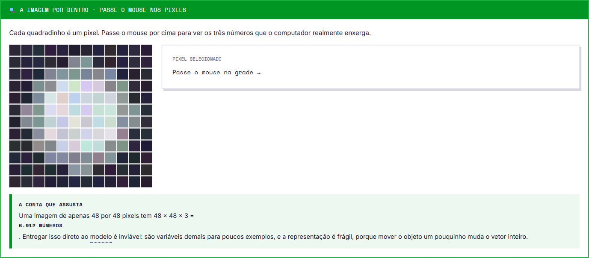
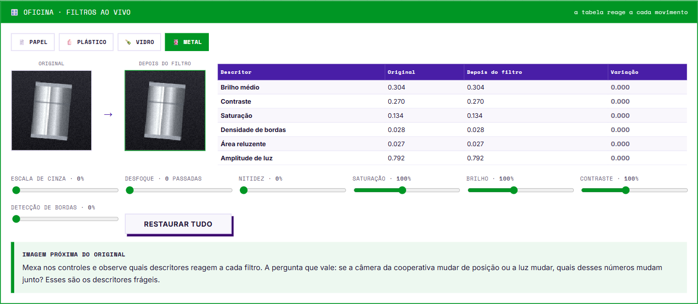

# Capítulo 3 · Visão computacional

6 seções, 4 exercícios, 3 atividades, ≈55 min.
A virada de chave: depois de **um passo só**, um problema de imagem vira exatamente o mesmo problema tabular do Capítulo 2.


## 3.1 · O computador não vê objetos, vê números



Cada pixel guarda três números (R, G, B).

**A conta que assusta:** uma imagem de 48 × 48 pixels tem 48 × 48 × 3 = **6.912 números**.
Entregar isso direto ao modelo é inviável: variáveis demais para poucos exemplos, e a representação é **frágil** — mover o objeto um pouquinho muda o vetor inteiro (o modelo aprenderia posição, não conteúdo).

## 3.2 · A solução: medir propriedades, não pixels

Em vez de 6.912 números, calcula-se **14 medidas que descrevem a imagem toda**: brilho, contraste, saturação, densidade de bordas, área reluzente.

```
Imagem (6.912 números)  →  Extração (14 medidas)  →  Tabela (1 linha por imagem)
                                                        = Capítulo 2 de novo
```

> **A pista veio de quem entende do assunto.** No caderno, a Dona Rosa, que separa material há 22 anos, descreve: *"o papel é fosco, o plástico tem cor forte, o vidro deixa a luz passar, o metal reflete"*. Sem saber, ela listou descritores mensuráveis. Projeto de IA aplicada dá errado quando a equipe técnica não conversa com quem conhece o problema.

**O insight central:** depois da extração valem os mesmos modelos e a mesma interface `fit`/`predict`. A especificidade do mundo das imagens ficou contida numa etapa só — isso se chama **separação entre representação e classificação**.

### Que descritor separa o quê

| Par difícil | Descritor que resolve | Por quê |
|---|---|---|
| Metal × Papel | **Área reluzente** | Metal produz reflexo especular concentrado; papel espalha a luz de forma difusa |
| Plástico colorido × Vidro transparente | **Saturação** | Embalagem plástica é fabricada com cor saturada; vidro tende ao neutro translúcido (o brilho seria parecido nos dois) |
| Vidro transparente × Plástico transparente | **Intensidade e concentração do reflexo** (descritor novo) | Cor deixa de separar; o que continua diferente é a propriedade óptica — vidro tem índice de refração maior e gera reflexo concentrado |

## 3.2b · Oficina de imagem



Filtros ao vivo (escala de cinza, desfoque, nitidez, saturação, brilho, contraste, detecção de bordas) sobre papel/plástico/vidro/metal, com a tabela de descritores reagindo a cada movimento.

**Roteiro de investigação:**

| Ação | Descoberta |
|---|---|
| Escala de cinza a 100% | **Saturação zera**, brilho e bordas quase não mudam → cor e forma são informações **independentes** |
| Desfoque em 4 | **Densidade de bordas despenca** (e o contraste cai junto) → é o que uma foto tremida em produção faz |
| Dessaturar o metal, depois o plástico | Ficam parecidos → apaga com as próprias mãos o descritor que os distinguia |
| Mexer só no brilho | Vários descritores mudam de uma vez → é isso que a iluminação do galpão faz sozinha ao longo do dia |

> Decisões de pré-processamento podem **destruir sinal**, e não só limpar ruído.

## 3.3 · Escala e pipeline

Os 14 descritores têm escalas muito diferentes: brilho médio vai de 0 a 1, densidade de bordas pode ir de 0 a 200.

| Sem padronizar | Com padronização |
|---|---|
| A variável que vai até 200 manda no resultado; a que vai até 1 quase não conta, mesmo separando melhor | Todas viram média zero e desvio um, e competem em pé de igualdade |

**Modelos de árvore não se importam com isso** (comparam limiares, não distâncias).

### Pipeline: o encadeamento disciplinado

```python
diagnostico = make_pipeline(
    StandardScaler(),
    LogisticRegression(max_iter=3000)
)

# no .fit()     → calcula média e desvio SÓ com o treino, e depois treina
# no .predict() → aplica a mesma transformação, sem recalcular nada
```

- **A ordem importa:** o transformador vem sempre **antes** do classificador (não dá para padronizar o resultado de uma classificação). Qualquer classificador pode entrar no lugar da logística.
- O pipeline calcula média e desvio **apenas no treino**. Essa disciplina evita que informação da validação vaze — é exatamente o princípio que, violado no Capítulo 4, produz o erro mais perigoso da fase.

## 3.3b · Os três modelos deste desafio

> **Por que reexplicar:** o mesmo modelo se comporta diferente conforme o dado. A floresta é a rainha do tabular e fica em segundo plano em visão. A logística, que sofre com interações no tabular, vai bem aqui depois da padronização. **Modelo bom não existe em abstrato: existe modelo bom para um problema.**

| Modelo | Papel no capítulo | Padronização |
|---|---|---|
| **SVC (SVM com núcleo RBF)** | Novo — costuma **vencer** nesta trilha | **Obrigatória** |
| **LogisticRegression** | Revisão — vai melhor aqui que no tabular, pois os descritores padronizados separam de forma razoavelmente linear; excelente linha de base | Necessária |
| **RandomForestClassifier** | Revisão — continua boa, mas costuma perder para o SVM: corta uma variável por vez em ângulo reto, e as classes formam nuvens arredondadas | **Não precisa** |

### SVM, em três frases

- **Como pensa:** procura a fronteira que separa os grupos com a **maior margem livre possível** dos dois lados. Não basta separar: quer separar com folga, porque folga costuma significar melhor generalização.
- **Analogia:** marcar a divisa entre dois terrenos ficando o mais longe possível das casas dos dois vizinhos. Divisa colada numa casa → qualquer erro de medida gera briga.
- **O que o núcleo RBF acrescenta:** sozinho o SVM traça uma reta; com RBF ele mede **distância** e desenha fronteiras curvas que contornam grupos arredondados — o formato que os descritores de imagem produzem.

> **`C` e `gamma` interagem.** Subir `C` sem controlar `gamma` quase sempre leva a sobreajuste, porque os dois empurram na mesma direção. Testem **em pares** e comparem sempre na validação, nunca no treino. Faixa útil de `C` aqui: entre 1 e 12.

Tabelas completas de parâmetros: [05-referencia-parametros.md](05-referencia-parametros.md).

## 3.5 · Ler o erro, e não só a nota

> No caderno, a Dona Rosa diz: *"vidro classificado como plástico vai para a prensa e danifica o equipamento. Papel como papelão só reduz um pouco o preço do lote."*
> Os dois são erro. Um custa caro, o outro nem tanto. **Só a matriz de confusão mostra qual está acontecendo.**

### Análise qualitativa de erros

Abrir as imagens que o modelo errou é prática padrão, não sinal de fracasso. As perguntas que valem:

| Pergunta | O que a resposta indica |
|---|---|
| **Um humano acertaria?** | Se nem vocês conseguem classificar, o limite está na **qualidade do rótulo**, não no modelo. Descoberta importante — vale reportar, porque nenhum ajuste de hiperparâmetro resolve rótulo inconsistente. |
| **Os erros têm algo em comum?** | Todos escuros? Todos com reflexo estranho? Se houver padrão, existe um **descritor novo** esperando para ser criado. |

E se o descritor novo não melhorar nada: **verifiquem com um gráfico** se ele realmente separa as duas classes confundidas antes de mexer no modelo. Distribuições sobrepostas = o descritor não carrega a informação que vocês supuseram.

### Deslocamento de domínio

As fotos vieram de um galpão específico, com uma câmera e uma luz específicas. O modelo aprende, **em parte, as condições da captura**, e não só o objeto. Levado para outra cooperativa, com outra iluminação, o desempenho cai mesmo com os mesmos materiais.
É uma das **maiores causas de falha em sistemas reais**.

## Checklist do Capítulo 3

- [ ] Sei explicar por que não entregamos os pixels direto ao modelo
- [ ] Entendi que extrair características transforma visão em problema tabular
- [ ] Sei quando padronizar importa e quando não faz diferença
- [ ] Sei o que é deslocamento de domínio e por que ele derruba sistemas reais
