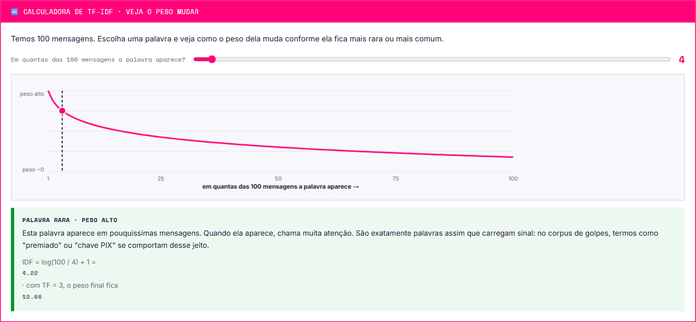
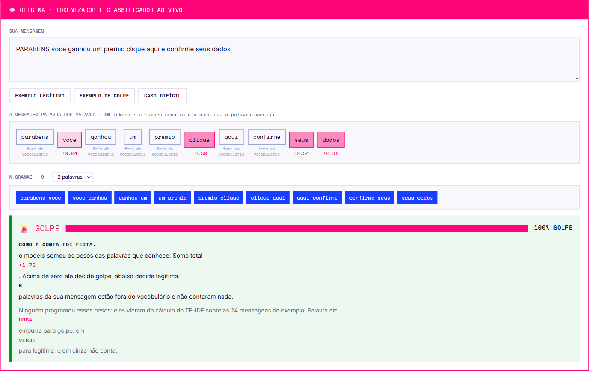

# Capítulo 4 · Linguagem natural

6 seções, 5 exercícios, 4 atividades, ≈60 min.
Guarda o **erro mais perigoso da Fase 1 inteira**: um erro que não trava o código, não mostra mensagem nenhuma e ainda **melhora** o resultado.


## 4.1 · Como transformar palavra em número: TF-IDF



| Fator | O que mede |
|---|---|
| **TF** — frequência no documento | Quantas vezes a palavra aparece **naquela mensagem** |
| **IDF** — raridade no conjunto | Inverso de em quantas mensagens a palavra aparece. Se aparece em **todas**, não distingue nada e o peso despenca |

> **A ideia, numa frase:** uma palavra é informativa quando é **frequente aqui e rara em todo o resto**.

Consequência elegante: "de", "para", "que" aparecem em quase toda mensagem, então o IDF derruba o peso delas sozinho. **Ninguém precisa fazer lista de palavras a ignorar** — a matemática resolve.

### N-gramas: quando a ordem importa

Olhar só palavras isoladas é o **saco de palavras**: o modelo sabe quais palavras existem, mas não em que sequência.

| | Sinal |
|---|---|
| **Só unigramas:** `conta` · `bloqueada` | Separadas, são neutras — "conta" aparece em mensagem legítima de banco o tempo todo |
| **Com bigramas:** `conta bloqueada` | Juntas, viram sinal forte. O bigrama recupera parte da informação de ordem |

**O custo:** bigramas e trigramas multiplicam o número de colunas → mais informação, mais risco de sobreajuste, mais tempo. No caderno de texto, **ampliar o vocabulário é a decisão que mais muda o resultado**.

## 4.1b · Oficina de texto



Digite qualquer mensagem: o material quebra em tokens, monta os n-gramas, calcula os pesos e classifica, mostrando **exatamente quais palavras pesaram**.

**Três experimentos:**

| Experimento | O que revela |
|---|---|
| Escreva um golpe **educado**, sem urgência e sem link | O escudo tende a errar: os marcadores fortes que ele aprendeu não aparecem. É o **problema adversarial** em miniatura — é exatamente o que quem escreve golpes faz |
| Escreva uma frase com gírias fora do corpus | As palavras simplesmente **não contam** — problema de **palavras fora do vocabulário**. Consequência de justiça: quem escreve num registro diferente do corpus recebe pior tratamento, sem que ninguém tenha programado isso |
| Troque o n-grama de 1 para 2 palavras | `conta bloqueada` aparece como unidade só — a informação de ordem sendo recuperada |

## 4.2 · O erro que não dá erro (vazamento de dados)

**O `fit` do vetorizador não é uma operação neutra.** Ele faz duas coisas:
1. Define **quais palavras** compõem o vocabulário.
2. Calcula o **IDF de cada palavra**, que depende das frequências de **todo o conjunto** ao qual foi ajustado.

Ou seja: **o vetorizador aprende** com os dados que recebe.

| Onde | Método correto | Por quê |
|---|---|---|
| **TREINO** | `fit_transform` | Estima vocabulário e IDF **e** transforma. O treino é justamente o que o modelo pode conhecer |
| **VALIDAÇÃO / TESTE** | `transform` | Apenas aplica o que já foi estimado. Simula mensagens que ainda não existiam |

> **Por que é tão perigoso:** não lança exceção. O código roda normal. E **a métrica melhora**.
> Sistemas que vão excelente na validação e mal em produção frequentemente têm aqui a causa. Como nada quebra, ninguém desconfia. A verificação do caderno detecta isso comparando o vocabulário obtido com o correto.

**O princípio geral, para levar para a vida:**
> Qualquer operação que **estime parâmetros a partir dos dados** deve ser ajustada só no treino e apenas aplicada aos demais. Vale para vocabulário, IDF, média, desvio-padrão e valor de imputação. Não é regra de texto: é regra de **todo** pré-processamento.

**Ordem correta do pipeline de texto** (a divisão vem **antes** de qualquer coisa que aprenda com os dados):

```python
X_tr_txt, X_va_txt, y_tr, y_va = train_test_split(msgs, rotulos, stratify=rotulos)

vetorizador = TfidfVectorizer(max_features=4000, ngram_range=(1,2), min_df=2)
X_tr = vetorizador.fit_transform(X_tr_txt)   # treino: estima E aplica
X_va = vetorizador.transform(X_va_txt)       # validação: SÓ aplica

modelo = LogisticRegression(max_iter=3000, class_weight="balanced")
modelo.fit(X_tr, y_tr)
previsoes = modelo.predict(X_va)
```

## 4.2b · Os três modelos deste desafio

> **Por que árvore e floresta não aparecem aqui:** depois do TF-IDF cada mensagem vira uma linha com **milhares de colunas**, quase todas zero (**matriz esparsa**). Uma árvore teria que escolher, a cada corte, entre milhares de palavras, e cada corte olharia uma palavra só — ela se perde. Os modelos abaixo lidam naturalmente com muitas colunas esparsas.

| Peça | Papel |
|---|---|
| **`TfidfVectorizer`** | O tradutor. **Seus parâmetros mudam o resultado mais que a escolha do classificador** |
| **`LogisticRegression`** | Aprende literalmente um peso por palavra; a mais interpretável; costuma ser a melhor das três com dados suficientes |
| **`LinearSVC`** | Maior margem, mas **só fronteira reta**, com implementação otimizada para muitos atributos. Regra prática: **muitas colunas pedem modelo linear**. Não tem `predict_proba` |
| **`MultinomialNB`** | Probabilidade por palavra; absurdamente rápido; linha de base clássica. **Não aceita `class_weight`** — o caminho é `class_prior` |

**Naive Bayes, de onde vem o "ingênuo":** assume que as palavras aparecem de forma **independente**, o que em linguagem é claramente falso ("conta" e "bloqueada" andam juntas). A suposição é errada e o modelo funciona surpreendentemente bem — um dos resultados mais curiosos da área.

### Qual escolher primeiro

1. **Naive Bayes** — só para ter um número de referência em segundos. Se um modelo sofisticado não superar o NB, algo está errado no pipeline.
2. **Regressão Logística** — costuma ser a melhor, e deixa vocês verem os pesos das palavras.
3. **SVM Linear** — vale testar em seguida; às vezes ganha por pouco.

> **O erro de foco mais comum:** passar a tarde trocando de classificador. Neste desafio **mexer no vetorizador rende muito mais** — ampliar o vocabulário e incluir bigramas muda o resultado em dezenas de pontos, trocar de modelo muda poucos. **Ajustem o tradutor antes do classificador.**

Tabelas completas de parâmetros: [05-referencia-parametros.md](05-referencia-parametros.md).

## 4.4 · Nem todo erro custa o mesmo

| Erro | O que é | Custo |
|---|---|---|
| **Falso positivo** | Mensagem legítima marcada como golpe | A pessoa confere no app à toa. Incomoda e ninguém se machuca |
| **Falso negativo** | Golpe classificado como legítimo | A mensagem chega na tela de alguém. Pode significar **perda irreversível de dinheiro** |

> **O compromisso que não tem solução técnica:** tornar o modelo mais sensível **sobe a revocação e derruba a precisão**; mais conservador faz o inverso. **Não existe configuração que melhore as duas ao mesmo tempo.**
> A posição escolhida depende do custo no mundo real — é **decisão de projeto**, não problema de otimização. Cuidado com a intuição de maximizar revocação a qualquer preço: alarme falso demais faz o usuário desligar o sistema, e aí a revocação real vira zero.

### Problema adversarial e deriva conceitual

Diferença deste problema em relação aos outros dois: **alguém do outro lado está tentando furar o filtro**. Quem escreve golpes lê os padrões e adapta a redação.

**Consequência:** a distribuição dos dados muda ao longo do tempo — **deriva conceitual**. Um modelo treinado com as mensagens de hoje tem prazo de validade.

> Quem entrega um classificador sem plano de monitoramento **entregou metade do sistema**.

**Como perceber a deriva sem ter o rótulo verdadeiro** (monitorar as entradas):
- proporção de termos fora do vocabulário subindo;
- distribuição das pontuações do modelo se concentrando no meio;
- comprimento médio das mensagens mudando.

São sinais indiretos, mas chegam **antes do prejuízo**. E o plano precisa ser **rotina periódica** de retreino e monitoramento — retreinar uma vez conserta hoje e quebra de novo em dois meses.

## Checklist final da imersão

- [ ] Sei explicar o TF-IDF e por que ele derruba o peso de palavras comuns
- [ ] Sei a diferença entre `fit_transform` e `transform`, e o que cada um faz
- [ ] Sei explicar o que é vazamento de dados e por que ele passa despercebido
- [ ] Sei que precisão e revocação se opõem e que a escolha depende do custo real
- [ ] Sei como a Fase 1 será avaliada nas três camadas
