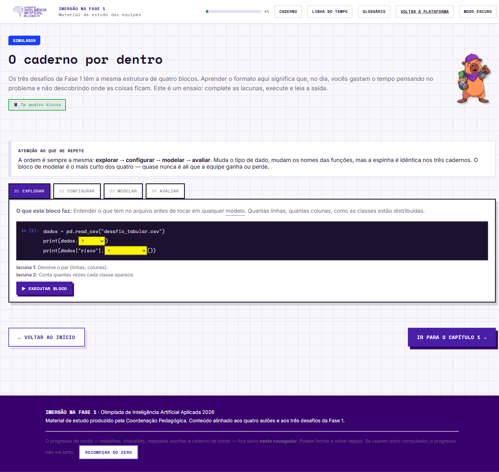

# O caderno por dentro — os quatro blocos

Os três desafios da Fase 1 têm a **mesma estrutura de quatro blocos**. Muda o tipo de dado, mudam os nomes das funções, a espinha é idêntica.

> **explorar → configurar → modelar → avaliar**
> O bloco de *modelar* é o mais curto dos quatro — quase nunca é ali que a equipe ganha ou perde.



## Bloco 01 · EXPLORAR

**Objetivo:** entender o que tem no arquivo antes de tocar em qualquer modelo. Quantas linhas, quantas colunas, como as classes se distribuem.

```python
dados = pd.read_csv("desafio_tabular.csv")
print(dados.shape)                    # (linhas, colunas)
print(dados["risco"].value_counts())  # conta cada classe
```

```
(3600, 12)
baixo     2592
medio      684
alto       324
Name: risco, dtype: int64
```

**Como ler:** 2.592 de 3.600 são risco baixo = **72%**. Esse número é a armadilha da acurácia do Capítulo 2.

## Bloco 02 · CONFIGURAR

**Objetivo:** separar o que o modelo vai ver do que fica reservado para avaliar. **É aqui que se evita o vazamento.**

```python
X = dados.drop(columns=["risco"])
y = dados["risco"]
X_treino, X_valida, y_treino, y_valida = train_test_split(
    X, y, test_size=0.2, stratify=y, random_state=42)
```

```
X_treino: (2880, 11)
X_valida: (720, 11)
proporção de "alto" no treino:   0.090
proporção de "alto" na validação: 0.090
```

**Como ler:** o `stratify` mantém os 9% de risco alto iguais dos dois lados. Sem ele, a validação pode sair com quase nenhum caso raro e a métrica vira sorte.

## Bloco 03 · MODELAR

**Objetivo:** treinar. O bloco mais curto — e é por isso que quase nunca é onde a equipe ganha ou perde.

```python
modelo = RandomForestClassifier(
    n_estimators=300, max_depth=8, random_state=42)
modelo.fit(X_treino, y_treino)
```

```
RandomForestClassifier(max_depth=8, n_estimators=300, random_state=42)
tempo de treino: 1.8 s
```

**Como ler:** três linhas. O trabalho de verdade estava no bloco anterior e está no próximo.

## Bloco 04 · AVALIAR

**Objetivo:** descobrir se o resultado presta — usando a métrica certa, não a mais bonita.

```python
pred = modelo.predict(X_valida)
print(f1_score(y_valida, pred, average="macro"))
```

```
F1-macro:      0.617
acurácia:      0.884

por classe:
  baixo  F1 = 0.94
  medio  F1 = 0.52
  alto   F1 = 0.39
```

**Como ler:** acurácia de 88% e F1-macro de 0,62. A **diferença entre os dois números é a história inteira**: o modelo vai bem na classe fácil e mal justamente onde importa.

---

## Pipeline canônico por desafio

**Tabular (1)**

```python
X = dados.drop(columns=["risco"]); y = dados["risco"]
X_tr, X_va, y_tr, y_va = train_test_split(X, y, test_size=0.2, stratify=y, random_state=42)
modelo = RandomForestClassifier(n_estimators=300, max_depth=12,
                                class_weight="balanced", n_jobs=-1, random_state=42)
modelo.fit(X_tr, y_tr)
print(f1_score(y_va, modelo.predict(X_va), average="macro"))
```

**Visão (2)** — descritores + padronização dentro do pipeline

```python
tabela = medir_descritores(imagens)        # cada imagem -> 1 linha de 14 números
X_tr, X_va, y_tr, y_va = train_test_split(tabela, rotulos, stratify=rotulos, random_state=42)
modelo = make_pipeline(StandardScaler(), SVC(C=4, kernel="rbf", gamma="scale"))
modelo.fit(X_tr, y_tr)
print(f1_score(y_va, modelo.predict(X_va), average="macro"))
```

**Texto (3)** — dividir **antes** de ajustar o vetorizador

```python
X_tr_txt, X_va_txt, y_tr, y_va = train_test_split(msgs, rotulos, stratify=rotulos, random_state=42)
vet = TfidfVectorizer(max_features=4000, ngram_range=(1,2), min_df=2,
                      strip_accents="unicode", sublinear_tf=True)
X_tr = vet.fit_transform(X_tr_txt)   # estima E aplica
X_va = vet.transform(X_va_txt)       # SÓ aplica
modelo = LogisticRegression(C=4, max_iter=3000, class_weight="balanced")
modelo.fit(X_tr, y_tr)
print(f1_score(y_va, modelo.predict(X_va), average="macro"))
```

## A ordem é dependência, não convenção

```
separar X e y  →  dividir treino/validação  →  construir o modelo
               →  fit no treino  →  predict na validação  →  medir
```

Não dá para treinar antes de construir, nem prever antes de treinar, nem medir antes de prever.
Em texto o ponto crítico é o primeiro: **a divisão vem antes de qualquer coisa que aprenda com os dados**. Vetorizador ajustado antes da divisão já viu a validação inteira.

## Caderno de bordo da equipe

Instrumento da recomendação "um fator por vez". Cada mudança é registrada **antes de rodar**, fica salva no navegador e é exportável em CSV para anexar ao relatório.

| O que mudamos | O que esperávamos | O que aconteceu | Por quê |
|---|---|---|---|
| | | | |
