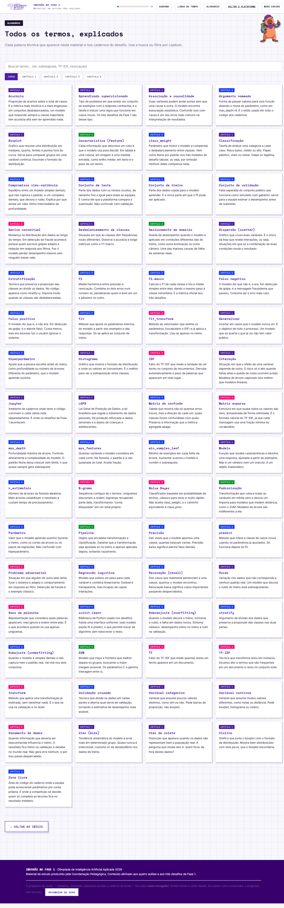

# Glossário — 65 termos

Todos os termos técnicos do material e dos cadernos. Feito para consulta durante a semana do desafio.
A coluna *Cap.* indica o capítulo em que o termo é introduzido.

## Todos os termos

| Termo | Cap. | Definição |
|---|---|---|
| **Acurácia** | 1 | Proporção de acertos sobre o total de casos. É a métrica mais intuitiva e a mais enganosa: em conjuntos desbalanceados, um modelo que responde sempre a classe majoritária tem acurácia alta sem ter aprendido nada. |
| **Aprendizado supervisionado** | 1 | Tipo de problema em que existe um conjunto de exemplos com a resposta conhecida, e a tarefa é induzir uma regra que funcione em casos novos. Os três desafios da Fase 1 são desse tipo. |
| **Associação e causalidade** | 1 | Duas variáveis podem andar juntas sem que uma cause a outra. O modelo encontra associação estatística. Confundir isso com causa é um dos erros mais comuns na interpretação de resultados. |
| **Argumento nomeado** | 2 | Forma de passar valores para uma função dizendo o nome do parâmetro, como em max_depth=8. É o estilo usado em todo o código dos cadernos. |
| **Boxplot** | 1 | Gráfico que resume uma distribuição em mediana, quartis, limites e pontos fora da curva. Serve para comparar grupos em uma variável contínua. Esconde o formato da distribuição. |
| **Característica (feature)** | 3 | Cada informação que descreve um caso e que o modelo usa para decidir. Em tabela é uma coluna; em imagem é uma medida extraída, como brilho médio; em texto é o peso de um termo. |
| **class_weight** | 2 | Parâmetro que instrui o modelo a compensar o desbalanceamento entre classes. Vem como None por padrão nos três modelos do desafio tabular, ou seja, por omissão nenhum deles compensa nada. |
| **Classificação** | 1 | Tarefa de atribuir uma categoria a cada caso. Risco baixo, médio ou alto. Papel, plástico, vidro ou metal. Golpe ou legítima. |
| **Compromisso viés-variância** | 2 | Equilíbrio entre um modelo simples demais, que não captura o padrão, e um complexo demais, que decora o ruído. Explica por que existe um valor ótimo intermediário de profundidade. |
| **Conjunto de teste** | 2 | Parte dos dados com os rótulos ocultos, de tamanho fixo e igual para todas as equipes. É contra ele que a plataforma compara a submissão. Não confundir com validação. |
| **Conjunto de treino** | 2 | Parte dos dados usada para o modelo aprender. É a única parte em que o fit pode ser aplicado. |
| **Conjunto de validação** | 2 | Fatia separada do conjunto público que funciona como simulado com gabarito: serve para a equipe estimar o desempenho antes de submeter. |
| **Deriva conceitual** | 4 | Mudança na distribuição dos dados ao longo do tempo. Em detecção de fraude acontece porque quem escreve golpes adapta a redação em resposta aos filtros. Faz o modelo perder desempenho mesmo sem ninguém mexer nele. |
| **Desbalanceamento de classes** | 1 | Situação em que as classes têm frequências muito diferentes. Distorce a acurácia e exige métricas como o F1-macro. |
| **Deslocamento de domínio** | 3 | Queda de desempenho quando o modelo é aplicado em condições diferentes das do treino, como outra iluminação ou outra câmera. Uma das maiores causas de falha de sistemas reais. |
| **Dispersão (scatter)** | 1 | Gráfico que cruza duas variáveis. É o único da lista que revela interações, ou seja, situações em que só a combinação de duas condições muda o resultado. |
| **Estratificação** | 2 | Técnica que preserva a proporção das classes ao dividir os dados. No código aparece como stratify=y. Importa muito quando as classes são desbalanceadas. |
| **F1** | 2 | Média harmônica entre precisão e revocação. Combina os dois erros num número só, penalizando quem é bom em um e péssimo no outro. |
| **F1-macro** | 2 | Calcula o F1 de cada classe e tira a média simples entre elas, dando o mesmo peso à classe minoritária. É a métrica oficial dos três desafios. |
| **Falso negativo** | 2 | O modelo diz que não é, e era. Em detecção de golpe, é a mensagem fraudulenta que passou. Costuma ser o erro mais caro. |
| **Falso positivo** | 2 | O modelo diz que é, e não era. Em detecção de golpe, é o alarme falso. Custa menos, mas em excesso faz o usuário ignorar o sistema. |
| **fit** | 2 | Método que ajusta os parâmetros internos do modelo a partir dos exemplos e das respostas. Só se aplica ao conjunto de treino. |
| **fit_transform** | 4 | Método do vetorizador que estima os parâmetros (vocabulário e IDF) e já aplica a transformação. Usa-se apenas no treino. |
| **Generalizar** | 1 | Acertar em casos que o modelo nunca viu. É o objetivo de todo o processo. Um modelo que só acerta o que já viu não tem valor prático. |
| **Hiperparâmetro** | 2 | Ajuste que a pessoa escolhe antes do treino, como profundidade ou número de árvores. Diferente do parâmetro, que o modelo aprende sozinho. |
| **Histograma** | 1 | Gráfico que mostra o formato da distribuição e onde os valores se concentram. É o melhor para ver a sobreposição entre classes. |
| **IDF** | 4 | Fator do TF-IDF que mede a raridade de um termo no conjunto de documentos. Derruba automaticamente o peso de palavras que aparecem em todo lugar. |
| **Interação** | 1 | Situação em que o efeito de uma variável depende de outra. O risco só é alto quando faltas altas e queda de notas ocorrem juntas. Modelos de árvore capturam isso melhor que modelos lineares. |
| **Jupyter** | 1 | Ambiente de cadernos onde texto e código convivem e cada célula roda separadamente. É onde os desafios da Fase 1 acontecem. |
| **LGPD** | 1 | Lei Geral de Proteção de Dados, a lei brasileira que regula o tratamento de dados pessoais. Dá proteção reforçada a dados sensíveis e a dados de crianças e adolescentes. |
| **Matriz de confusão** | 2 | Tabela que mostra não só quantos erros houve, mas a direção de cada um: quais classes foram confundidas com quais. Preserva a informação que a métrica agregada apaga. |
| **Matriz esparsa** | 4 | Estrutura em que quase todos os valores são zero, armazenada de forma otimizada. É o formato natural do TF-IDF, já que cada mensagem usa uma fração mínima do vocabulário. |
| **max_depth** | 2 | Profundidade máxima da árvore. Controla diretamente a complexidade do modelo. O padrão None deixa crescer sem limite, o que quase sempre gera sobreajuste. |
| **max_features** | 2 | Quantas variáveis o modelo considera em cada corte. Na floresta, o padrão é a raiz quadrada do total. Aceita fração. |
| **min_samples_leaf** | 2 | Mínimo de exemplos em cada folha da árvore. Aumentar suaviza o modelo e contém o sobreajuste. |
| **Modelo** | 1 | Função que recebe características e devolve uma resposta, ajustada a partir de exemplos. Não é um cérebro nem um oráculo: é um objeto matemático. |
| **n_estimators** | 2 | Número de árvores da floresta aleatória. Mais árvores estabilizam o resultado e custam tempo de processamento. |
| **N-grama** | 4 | Sequência contígua de n termos. Unigramas descartam a ordem; bigramas recuperam parte dela, transformando "conta bloqueada" em um sinal próprio. |
| **Naive Bayes** | 4 | Classificador baseado em probabilidade de termos, clássico para texto e muito rápido. Não aceita class_weight, e o caminho equivalente é class_prior. |
| **Padronização** | 3 | Transformação que coloca todas as variáveis em média zero e desvio um. Importa para modelos que medem distância, como o SVM. Modelos de árvore são indiferentes a ela. |
| **Parâmetro** | 2 | Valor que o modelo aprende sozinho durante o treino, como os cortes da árvore ou os pesos da regressão. Não confundir com hiperparâmetro. |
| **Pipeline** | 3 | Objeto que encadeia transformação e classificação. Garante que a transformação seja ajustada só no treino e apenas aplicada depois, evitando vazamento. |
| **Precisão** | 2 | Das vezes que o modelo apontou uma classe, quantas estavam certas. Precisão baixa significa alarme falso demais. |
| **predict** | 2 | Método que infere a classe de casos novos usando os parâmetros já ajustados. Só funciona depois do fit. |
| **Problema adversarial** | 4 | Situação em que alguém do outro lado tenta furar o sistema e adapta o comportamento em resposta ao filtro. Detecção de fraude é o exemplo clássico. |
| **Regressão logística** | 2 | Modelo que estima um peso para cada variável e combina linearmente. Estável e transparente, mas incapaz de captar interações. |
| **Revocação (recall)** | 2 | Dos casos que realmente pertenciam a uma classe, quantos o modelo encontrou. Revocação baixa significa casos importantes passando despercebidos. |
| **Ruído** | 1 | Variação nos dados que não corresponde a nenhum padrão real. Um modelo que decora o ruído do treino está sobreajustando. |
| **Saco de palavras** | 4 | Representação que considera quais palavras aparecem, mas ignora a ordem entre elas. É o que acontece quando se usa apenas unigramas. |
| **scikit-learn** | 2 | Biblioteca de Python usada nos desafios. Adota uma interface uniforme: todo modelo expõe fit e predict, o que permite trocar de algoritmo sem reescrever o resto. |
| **Sobreajuste (overfitting)** | 2 | Quando o modelo decora o treino, inclusive o ruído, e falha em dados novos. Sintoma clássico: desempenho ótimo no treino e ruim na validação. |
| **stratify** | 2 | Argumento da divisão dos dados que preserva a proporção das classes nas duas partes. |
| **Subajuste (underfitting)** | 2 | Quando o modelo é simples demais e não captura nem o padrão real. Vai mal nos dois conjuntos. |
| **SVM** | 3 | Modelo que traça a fronteira que melhor separa os grupos, buscando a maior margem possível. Os parâmetros C e gamma interagem entre si. |
| **TF** | 4 | Fator do TF-IDF que mede quantas vezes um termo aparece em um documento. |
| **TF-IDF** | 4 | Técnica que transforma texto em números. Dá peso alto a termos que são frequentes em um documento e raros no conjunto todo. |
| **transform** | 4 | Método que aplica uma transformação já estimada, sem reestimar nada. É o que se usa na validação e no teste. |
| **Validação cruzada** | 2 | Técnica que divide os dados em várias partes e alterna qual serve de validação, tornando a estimativa de desempenho mais estável. |
| **Variável categórica** | 1 | Variável que assume poucos valores distintos, como sim ou não. Pede barras de proporção, não boxplot. |
| **Variável contínua** | 1 | Variável que assume muitos valores diferentes, como notas ou distância. Pede boxplot, histograma ou violino. |
| **Vazamento de dados** | 4 | Quando informação que deveria ser desconhecida influencia o treino. O resultado fica ótimo na validação e desaba no mundo real. Não gera erro nenhum, e por isso passa despercebido. |
| **Viés (bias)** | 1 | Tendência sistemática do modelo a errar mais em determinado grupo. Quase nunca é intencional: costuma vir de desequilíbrio nos dados de treino. |
| **Viés de coleta** | 1 | Distorção que aparece quando os dados não representam bem a população real. A pergunta que revela isso é: quem ficou de fora destes dados? |
| **Violino** | 1 | Gráfico que junta o boxplot com o formato da distribuição. Mostra bem distribuições com dois picos, que o boxplot esconderia. |
| **Zona livre** | 2 | Área do código do caderno onde a equipe pode acrescentar parâmetros por conta própria. É onde a competição se decide: quem só completa as lacunas fica no resultado mediano. |

## Índice por capítulo

**Cap. 1 · Ética e dados** (19 termos): Acurácia - Aprendizado supervisionado - Associação e causalidade - Boxplot - Classificação - Desbalanceamento de classes - Dispersão (scatter) - Generalizar - Histograma - Interação - Jupyter - LGPD - Modelo - Ruído - Variável categórica - Variável contínua - Viés (bias) - Viés de coleta - Violino

**Cap. 2 · Tabular** (29 termos): Argumento nomeado - class_weight - Compromisso viés-variância - Conjunto de teste - Conjunto de treino - Conjunto de validação - Estratificação - F1 - F1-macro - Falso negativo - Falso positivo - fit - Hiperparâmetro - Matriz de confusão - max_depth - max_features - min_samples_leaf - n_estimators - Parâmetro - Precisão - predict - Regressão logística - Revocação (recall) - scikit-learn - Sobreajuste (overfitting) - stratify - Subajuste (underfitting) - Validação cruzada - Zona livre

**Cap. 3 · Visão** (5 termos): Característica (feature) - Deslocamento de domínio - Padronização - Pipeline - SVM

**Cap. 4 · Texto** (12 termos): Deriva conceitual - fit_transform - IDF - Matriz esparsa - N-grama - Naive Bayes - Problema adversarial - Saco de palavras - TF - TF-IDF - transform - Vazamento de dados
