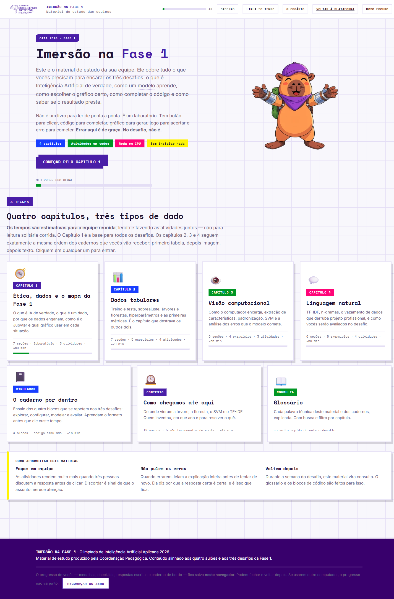

# Imersão na Fase 1 — OIAA 2026

Documentação do material de estudo em `https://olimpiadadeia.ceia.digital/imersao`
(conteúdo servido por `GET /api/imersao/conteudo`, exige sessão autenticada).

> Material de estudo das equipes, produzido pela Coordenação Pedagógica.
> Alinhado aos 4 aulões e aos 3 desafios da Fase 1. Roda em CPU, sem instalar nada.
> Progresso (medalhas, checklists, respostas escritas, caderno de bordo) fica em `localStorage` — **não** sincroniza entre computadores.

## Índice

| Arquivo | Conteúdo |
|---|---|
| [01-cap1-etica-dados-graficos.md](01-cap1-etica-dados-graficos.md) | Ética, LGPD, regra vs. modelo, Jupyter, tipos de dado, escolha de gráfico |
| [02-cap2-tabular.md](02-cap2-tabular.md) | Treino/validação/teste, sobreajuste, árvore/floresta/logística, hiperparâmetros, métricas |
| [03-cap3-visao.md](03-cap3-visao.md) | Pixel → descritor, padronização, pipeline, SVM RBF, análise de erros |
| [04-cap4-texto.md](04-cap4-texto.md) | TF-IDF, n-gramas, vazamento de dados, modelos lineares, custo do erro |
| [05-referencia-parametros.md](05-referencia-parametros.md) | Todas as tabelas de hiperparâmetros consolidadas |
| [06-caderno-4-blocos.md](06-caderno-4-blocos.md) | Estrutura dos cadernos: explorar → configurar → modelar → avaliar |
| [07-glossario.md](07-glossario.md) | 65 termos |
| [08-linha-do-tempo.md](08-linha-do-tempo.md) | 12 marcos históricos (5 são ferramentas dos cadernos) |
| [09-gabarito-atividades.md](09-gabarito-atividades.md) | Respostas e explicações de todos os quizzes e exercícios |
| [10-cola-rapida.md](10-cola-rapida.md) | Cheat sheet para usar durante o desafio |

## Os três desafios

| # | Dado | Tarefa | Classes | Teste oculto |
|---|---|---|---|---|
| 1 | Tabela — estudantes | Risco de evasão | 3 (baixo/médio/alto) | 900 linhas |
| 2 | Imagem — fotos de resíduos | Tipo de material | 4 (papel/plástico/vidro/metal) | 240 linhas |
| 3 | Texto — mensagens de celular | Golpe ou legítima | 2 | 900 linhas |

Três dados diferentes, **o mesmo problema**: classificação supervisionada.
Métrica oficial dos três: **F1-macro**.

## Estrutura do material

4 capítulos + 3 anexos, ~4h de trabalho em equipe:

| Capítulo | Conteúdo | Tempo |
|---|---|---|
| 1 · Ética, dados e o mapa | 7 seções · laboratório · 3 atividades | ≈50 min |
| 2 · Dados tabulares | 7 seções · 5 exercícios · 4 atividades | ≈70 min |
| 3 · Visão computacional | 6 seções · 4 exercícios · 3 atividades | ≈55 min |
| 4 · Linguagem natural | 6 seções · 5 exercícios · 4 atividades | ≈60 min |
| 📓 O caderno por dentro | Simulador dos 4 blocos | ≈15 min |
| 🕰️ Como chegamos até aqui | 12 marcos históricos | ≈12 min |
| 📖 Glossário | Consulta rápida | — |

O Capítulo 2 destrava os outros dois: o que se aprende lá se repete quase sem mudança em visão e texto.

## Como vocês serão avaliados (3 camadas)

| Camada | O que é | Peso prático |
|---|---|---|
| 1 · Desempenho | Modelo aplicado ao teste oculto, medido pela métrica oficial | Nota principal |
| 2 · Processo | Verificações automáticas registram cada passo → **pontuação parcial** | Valoriza quem entendeu o caminho |
| 3 · Explicação | Relatório escrito ao final de cada caderno | Desempate; separa quem operou de quem compreendeu |

**Três coisas que reduzem a ansiedade:**
1. Vale a **melhor** submissão, não a última — experimentar não custa nada.
2. Pontuação parcial existe: acertar o passo conta mesmo com resultado final pior.
3. Alterem **um fator por vez** e anotem o efeito (é para isso que existe o *caderno de bordo*, exportável em CSV).

## Recursos interativos (não reproduzíveis em .md)

8 laboratórios ao vivo, 30 blocos de código, 15 tabelas de referência, ~20 atividades avaliadas com medalha.
Ver screenshots em [`img/`](img/) e o gabarito em [09-gabarito-atividades.md](09-gabarito-atividades.md).

## Fontes brutas (pasta `_work/`)

| Arquivo | O que é |
|---|---|
| `conteudo.html` | HTML completo devolvido por `/api/imersao/conteudo` (410 KB, SPA autocontida) |
| `conteudo_full.md` | Transcrição integral do texto estático (85 KB) — fonte desta documentação |
| `s0.js` … `s4.js` | Scripts inline extraídos: dados dos laboratórios, glossário, linha do tempo, quizzes e gabaritos |
| `app.js` | Bundle React da plataforma (rotas, telas de login/tutor/admin) |

Rotas da plataforma vistas no bundle: `/home`, `/imersao`, `/monitor`, `/login`, `/registrar`, `/perfil`, `/privacidade`, `/recuperar-senha`, `/redefinir-senha`, `/verificar-email`, `/tutor/dashboard`, `/tutor/equipes/nova`, `/participante/dashboard`, `/participantes/registrar`, `/participantes/verificar-email`, `/admin/dashboard`, `/admin/inscricoes/:id`, `/admin/relatorios`, `/admin/administradores`, `/admin/suporte/tutor/:id`, `/admin/suporte/participante/:id`.
